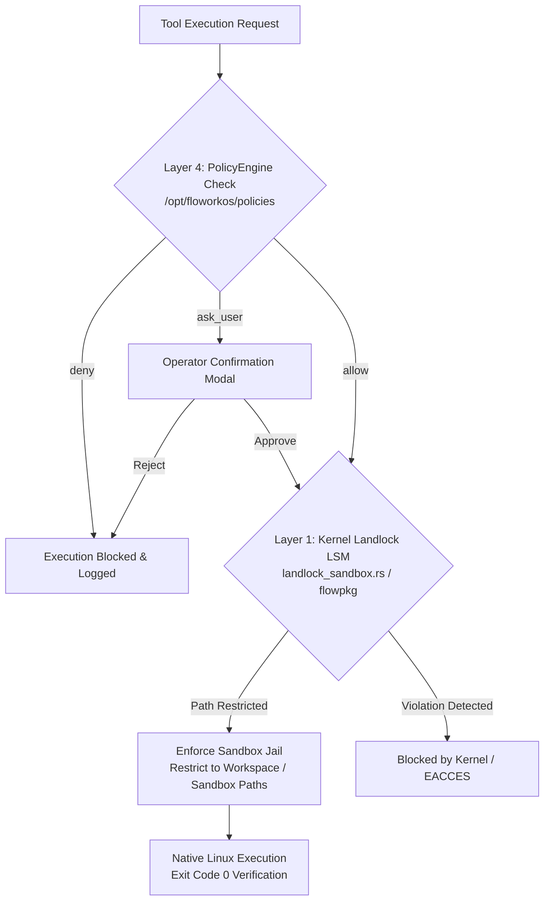

# 🏛️ Flowork OS — Master Sovereign Architecture Specification (`ARCHITECT.md`)

```text
  ███████╗██╗      ██████╗ ██╗    ██╗ ██████╗ ██████╗ ██╗  ██╗     ██████╗ ███████╗
  ██╔════╝██║     ██╔═══██╗██║    ██║██╔═══██╗██╔══██╗██║ ██╔╝    ██╔═══██╗██╔════╝
  █████╗  ██║     ██║   ██║██║ █╗ ██║██║   ██║██████╔╝█████╔╝     ██║   ██║███████╗
  ██╔══╝  ██║     ██║   ██║██║███╗██║██║   ██║██╔══██╗██╔═██╗     ██║   ██║╚════██║
  ██║     ███████╗╚██████╔╝╚███╔███╔╝╚██████╔╝██║  ██║██║  ██╗    ╚██████╔╝███████║
  ╚═╝     ╚══════╝ ╚═════╝  ╚══╝╚══╝  ╚═════╝ ╚═╝  ╚═╝╚═╝  ╚═╝     ╚═════╝ ╚══════╝
```

> **Authoritative Specification Version:** 1.0.0-SOVEREIGN  
> **Target Operating System:** Flowork OS (Rust-Integrated Sovereign Linux)  
> **Kernel Architecture:** `Linux 7.3.0-flowork-rust` (Eust Kernel Core)  
> **System Territory:** `/opt/floworkos`  
> **Security Baseline:** Landlock LSM + Tiered TOML Policy Governance Engine  

---

## 1. Executive Vision & Core Doctrines

**Flowork OS** is an autonomous, sovereign, agent-native desktop operating system. It merges a high-performance Linux foundation—hardened by a custom **Rust-integrated kernel**—with an autonomous cognitive runtime engine (**Mr. Flow**), decoupled native tooling, declarative security policies, and sub-millisecond environmental instincts.

### The Five Invariant Doctrines
1. **Zero-Trust Sovereign Independence**: Flowork OS relies on no proprietary external ecosystems, third-party corporate preambles, or unverified upstream telemetry.
2. **Radical Non-Dualism**: *"Flowork is Linux. Linux applications are Flowork applications."* Every standard Linux binary, desktop protocol, and POSIX primitive is a native Flowork asset.
3. **Cinnamon Identity Eradication**: All legacy desktop identity is completely replaced with the bespoke Flowork Quantum Glass desktop interface.
4. **Empirical Verification (Exit Code 0)**: Every system assertion, tool invocation, and build artifact must be backed by reproducible terminal evidence with Exit Code 0.
5. **Sacred Code Locks (`@lock` & `@freez`)**: Invariant configuration files and security boundaries marked with protection tags remain strictly immutable.

---

## 2. High-Level System Architecture

Flowork OS operates as a unified vertical architecture spanning from bare-metal kernel modules up to Pure Rust daemons, autonomous subagents, and the user desktop shell:

```mermaid
graph TD
    subgraph Layer5["Layer 5: Sovereign UI & Desktop Shell"]
        UI_WM["Pure Rust Compositor & WM (flowork-wm / flowork-compositor)"]
        UI_NEMO["Nemo File Manager (12 Pinned Sovereign Bookmarks)"]
        UI_HUD["Alacritty Glass HUD, Plank Dock, Launchpad & Companion Sidebar"]
    end

    subgraph Layer4["Layer 4: Sovereign Modular Subsystems (The 12 Bookmarked Pillars)"]
        M1["📸 Screenshots (/opt/floworkos/screenshots)"]
        M2["⚡ Prompts (/opt/floworkos/system/system_promp/promps)"]
        M3["🛠️ Tools (/opt/floworkos/tools)"]
        M4["🤖 Subagents (/opt/floworkos/agents)"]
        M5["🔌 MCP Servers (/opt/floworkos/mcp)"]
        M6["⚖️ Policies (/opt/floworkos/policies)"]
        M7["💡 Skills (/opt/floworkos/skills)"]
        M8["🎯 Active Triggers (/opt/floworkos/system/triger)"]
        M9["📜 Rules & Triggers (/opt/floworkos/system/system_promp)"]
        M10["💬 Chat History (/opt/floworkos/history/chats)"]
        M11["⚡ Connector Gateway (/opt/floworkos/connector)"]
        M12["🚀 Applications (/opt/floworkos/apps)"]
    end

    subgraph Layer3["Layer 3: Autonomous Cognitive Engine (Mr. Flow CLI)"]
        CLI_MR["Mr. Flow CLI Runtime (/usr/local/bin/mrflow -> /opt/floworkos/bin/mrflow)"]
        CLI_ASM["Prompt Assembler & Formula 5-3-3 Sliding Router"]
        CLI_RUST_RULES["78 Rust Passive Rules / 83 Compiled ELF Binaries (.bin/)"]
        CLI_ACT_WATCH["Active Trigger Watchdog (/tmp/flowork_active_trigger.json)"]
    end

    subgraph Layer2["Layer 2: Pure Rust Infrastructure Daemons"]
        SYSD_CORE["flowork-sysd HTTP Control Plane (/usr/local/bin/flowork-sysd :18090)"]
        BUS_CORE["flowork-neural-bus Event & Pipe Fabric (:18095 / bus.sock)"]
        CONN_CORE["flowork-connector Inference Gateway (:9099)"]
        EDITS_CORE["flowork-edits-daemon Media Range Server (:3456) & FlowFS Indexer"]
    end

    subgraph Layer1["Layer 1: Rust-Integrated Linux Kernel (Eust Kernel)"]
        KERN["Linux Kernel 7.3.0-flowork-rust"]
        KERN_RUST["Kernel Space Rust Subsystem (Memory Safety & Zero Data Race)"]
        KERN_LANDLOCK["Landlock LSM Sandboxing (landlock_sandbox.rs & flowpkg syscall 444)"]
        KERN_DRM["Direct Rendering Manager Capture (drm_capture.rs)"]
        KERN_UINPUT["UInput Virtual Input Device Subsystem (uinput_ctrl.rs)"]
        KERN_SURV["Kernel Telemetry & Surveillance (kernel_surveillance.rs)"]
    end

    Layer1 --> Layer2
    Layer2 --> Layer3
    Layer3 --> Layer4
    Layer4 --> Layer5
```



---

## 3. Deep Architectural Layer Breakdown

### Layer 1: Rust-Integrated Linux Kernel (`Eust Kernel`)
* **Kernel Version:** `Linux 7.3.0-flowork-rust` (`#7 SMP PREEMPT_DYNAMIC` / Eust Kernel)
* **Core Rationale:** By integrating Rust directly into kernel space, Flowork OS eliminates entire classes of memory vulnerabilities (use-after-free, double-free, null pointer dereferences, data races) at ring 0.
* **Kernel Subsystems:**
  1. **Landlock LSM Sandboxing (`landlock_sandbox.rs` & `flowpkg`):** Enforces kernel-backed, unprivileged file path restriction rules (`syscall 444` Landlock rulesets), guaranteeing sandboxed runtimes and packages cannot escape authorized paths.
  2. **DRM Hardware Capture (`drm_capture.rs`):** Maps Linux Direct Rendering Manager framebuffer telemetry and hardware screen capture via `flowork-sysd` (`/api/system/display/*`).
  3. **UInput Virtual Controllers (`uinput_ctrl.rs`):** Emulates hardware-level HID input devices (keyboard, mouse) via `/dev/uinput` for deterministic desktop automation (`/api/agent/input/hardware`).
  4. **Kernel Surveillance (`kernel_surveillance.rs`):** Gathers low-overhead process lifecycle events and kernel health telemetry (`/api/kernel/*`).

---

### Layer 2: Pure Rust System Infrastructure Daemons
* **`flowork-sysd` System Control Plane (`/usr/local/bin/flowork-sysd`, source `/opt/floworkos/sysd/src/`):**
  - **Transport:** Local Axum HTTP REST API listening on **`http://127.0.0.1:18090`** (`FLOWORK_SYSD_PORT`).
  - **Modules (`sysd/src/`):**
    - `routes.rs` — Unified HTTP REST router (`/health`, `/api/system/*`, `/api/agent/*`, `/api/kernel/*`, `/v1/chat/completions`).
    - `cdp_pool.rs` & `agent_bridge.rs` — Persistent Chromium CDP pool, DOM mapping, interactive input, and agent terminal bridge (`terminal_exec.rs`).
    - `x11_ctrl.rs`, `sidebar_geometry.rs`, `dbus_ctrl.rs` — X11/EWMH window tiling/focus, sidebar dock geometry, desktop notifications, power, and audio/MPRIS media control.
    - `drm_capture.rs`, `uinput_ctrl.rs`, `kernel_surveillance.rs`, `landlock_sandbox.rs` — Hardware capture, HID injection, netlink/kernel telemetry, and Landlock sandbox verification.
    - `chat_store.rs`, `embedded_slm.rs`, `reflex.rs`, `scratch_janitor.rs` — SQLite REST chat store, embedded local SLM hooks, reflex action dispatcher, and scratch cleanup.
* **Sibling Pure Rust Daemons (`crates/flowork-core-rs/`, `wm/`):**
  - **`flowork-neural-bus` (`/opt/floworkos/bin/flowork-neural-bus`):** Cross-app pub/sub, SSE stream, and pipeline orchestrator on **`http://127.0.0.1:18095`** (`FLOWORK_BUS_PORT`) plus UNIX socket (`bus.sock` / `/tmp/flowork-neural-bus.sock`), paired with `flowork-bus` and `flowork-pipe`.
  - **`flowork-edits-daemon` (`/opt/floworkos/bin/flowork-edits-daemon`):** HTTP byte-range streaming media server and `.bsleditsx` bundler on `http://127.0.0.1:3456` (`FLOWORK_EDITS_PORT`).
  - **`flowork-wm` (`/opt/floworkos/wm/`):** Custom Rust X11 window manager / compositor (`x11rb` + `cairo-rs`) integrated with the Quantum Glass UI shell.
  - **Core Utilities (`flowork-tool-discovery`, `flowork-tool-runner`, `flowork-tool-executor`, `flowork-lint-skills`):** Compiled Rust binaries backing tool discovery, skill linting, and execution.
  - **Resilience, Screen Memory & Dev Tooling:** `flowork-sentinel-daemon`, Time-Lock (`flowork-snapshot` / `flowork-rollback` with Btrfs subvolumes and ext4 archive fallback), **FlowFS** multimodal semantic index (`flowfs_core.py`, `flowfs-indexer-daemon`, `flowfs-search`), `flowork-ambient-eye` (`Super+Shift+A`), `flow-app` / `flowpkg` (`.flowapp` + `remix`), and OpenCodeReview (`ocr`).

---

### Layer 3: Autonomous Cognitive Engine (Mr. Flow CLI)
* **Executable:** `/usr/local/bin/mrflow` -> `/opt/floworkos/bin/mrflow` (Clean-room Pure Rust crate: `/opt/floworkos/mrflow-rs/`)
* **Assembly & Dynamic Context Engine:** Native Rust (`mrflow-rs/src/cognitive/mod.rs` evaluating `/opt/floworkos/system/system_promp/`)
* **Architecture:**
  - **Formula 5-3-3 Sliding Router (`Formula533Router`):** Scores active Intercept Gate `keywords`, `goal`, and `reason` signals (5 points per token hit; prompt threshold `>= 10` with per-session prompt deduplication) to inject **Top 5 Tools**, **Top 3 Skills**, and **Top 3 Conditional Prompts** dynamically without context bloat.
  - **Native Rust Passive Rule Evaluator:** Executes **78** Rust rule sources (`83` compiled ELF binaries in `/opt/floworkos/system/system_promp/rules/.bin/`) plus script checkers with a **50ms** timeout ceiling per rule, evaluating workspace landmarks, git status, active ports, and runtime metrics.
  - **Active Trigger Watchdog:** Checks `/tmp/flowork_active_trigger.json` (with **300s** freshness TTL) on every turn to prepend emergency system alerts written by `/opt/floworkos/system/triger/` watchdogs.
  - **Lossless JSONL Vault & Compression Checkpoints:** `SessionVault` (`mrflow-rs/src/session/mod.rs`) writes append-only session ledgers (`compression_snapshot` + `preservedTail`) so `--resume` reloads efficiently without losing original turns.
  - **Hybrid Tool Registry:** Dispatches fast native Rust built-in tools alongside **70** dynamic manifest-backed tools in `/opt/floworkos/tools/` and JIT-filtered MCP server tools.

---

### Layer 2.5: Sovereign Inference & Quota Gateway (Connector Subsystem :9099)
* **Location:** `/opt/floworkos/connector/` (Rust Source: `/opt/floworkos/connector-rs/`, Binary: `/usr/local/bin/flowork-connector` -> `/opt/floworkos/connector/bin/flowork-connector`)
* **Runtime Profile:** Self-contained Pure Rust Axum/Tokio native ELF binary with zero external Node/Bun dependencies.
* **Endpoints & Auxiliary Ports:** Main dual-protocol gateway on **`http://127.0.0.1:9099/`** (`/v1beta/models/*`, `/v1/chat/completions`, `/gui`, `/health`, `/auth/*`), plus auxiliary local OAuth callback listeners on **`:8080`** and **`:51121`**.
* **Architecture & Resilience:**
  - **Dynamic Multi-Account Quota Rotator:** Rotates Google CloudCode OAuth refresh tokens persisted in **`/opt/floworkos/connector/data/vault.json`** with smart HTTP 429 cooldown tracking.
  - **Single Model Lock Doctrine:** Normalizes inference requests cleanly to `gemini-3.8-flash-high` (`connector-rs/src/translator.rs`).
  - **Multi-Provider Failover Matrix:** Live switchboard across Google CloudCode, local Ollama (`http://127.0.0.1:11434`), and 9Router (`https://api.9router.com/v1` / local fallback `:20128`) driven by `/opt/floworkos/connector/config/{default,models,network,providers,settings}.json`.
  - **Local Fast-Path Optimization:** Intercepts pre-turn classifier calls in sub-millisecond Rust (`serde_json` in `providers.rs`) and condenses `<session_context>` payloads (`num_ctx: 8192`) for local models.

---

## 4. The 12 Canonical Sovereign Pillars (Detailed Specifications)

Flowork OS organizes all agent and desktop resources into **12 modular, bookmarked pillars** pinned in Nemo (`/etc/skel/.config/gtk-3.0/bookmarks`) alongside `README.md` and `ARCHITECT.md` (**14 canonical docs** referenced by `00_preamble.md`):

```text
/opt/floworkos/
├── apps/                      <-- 🚀 Sovereign Desktop & CLI Applications
├── connector/                 <-- ⚡ Connector Gateway (:9099)
├── screenshots/               <-- 📸 Screenshots & Ambient Sight Vault
├── system/
│   ├── system_promp/
│   │   ├── promps/            <-- ⚡ Master System Prompts
│   │   ├── rules/             <-- 📜 Rules & Triggers (Compiled Rust)
│   │   └── triggers.json
│   └── triger/                <-- 🎯 Active Trigger Daemons
├── tools/                     <-- 🛠️ Decoupled Tools Registry (70 manifests)
├── agents/                    <-- 🤖 Subagents Ecosystem
├── mcp/                       <-- 🔌 Model Context Protocol Servers
├── policies/                  <-- ⚖️ Tiered TOML Security Policies
├── skills/                    <-- 💡 20-Keyword Knowledge Skills
└── history/
    └── chats/                 <-- 💬 Episodic Chat History Vault
```

### Complete Cross-Reference Table

| # | Icon & Module | Canonical Path | Authoritative Documentation | Primary Architectural Function |
| :-: | :--- | :--- | :--- | :--- |
| **1** | **📸 Screenshots** | `/opt/floworkos/screenshots` | [README.md](file:///opt/floworkos/screenshots/README.md) | Universal visual capture vault; Ambient Eye captures (`Super+Shift+A`), WebP FlowFS thumbs, and CLI/agent screenshots. |
| **2** | **⚡ Prompts** | `/opt/floworkos/system/system_promp/promps` | [README.md](file:///opt/floworkos/system/system_promp/promps/README.md) | Canonical system prompt vault; houses preamble, mandates, `56` conditional triggers, `207` `browser_issues/` specs, and Formula 5-3-3 routing. |
| **3** | **🛠️ Tools** | `/opt/floworkos/tools` | [README.md](file:///opt/floworkos/tools/README.md) | Decoupled tool foundry (70 manifests); native Rust discovery (`flowork-tool-discovery`), runner (`flowork-tool-runner`), and `tool_foundry`. |
| **4** | **🤖 Subagents** | `/opt/floworkos/agents` | [README.md](file:///opt/floworkos/agents/README.md) | Subagent ecosystem; built-ins (`codebase_investigator`, `cli_help`, `kernel_sentinel`) plus YAML `.md` profiles with flat 1-level isolation. |
| **5** | **🔌 MCP Servers** | `/opt/floworkos/mcp` | [README.md](file:///opt/floworkos/mcp/README.md) | Model Context Protocol hub (`downflow-mcp`, `earshot`); `stdio`, `StreamableHttp`, and `SSE` JSON-RPC isolation decoupled from native tools. |
| **6** | **⚖️ Policies** | `/opt/floworkos/policies` | [README.md](file:///opt/floworkos/policies/README.md) | Dynamic TOML governance engine (`allow`, `ask_user`, `deny`) + safety checkers (`allowed-path`, `conseca`) across tiered search paths. |
| **7** | **💡 Skills** | `/opt/floworkos/skills` | [README.md](file:///opt/floworkos/skills/README.md) | Procedural SOP knowledge repository (14 skills); strictly enforced by `flowork-lint-skills` with **exactly 20 English keywords**. |
| **8** | **🎯 Active Triggers** | `/opt/floworkos/system/triger` | [README.md](file:///opt/floworkos/system/triger/README.md) | Asynchronous daemon supervisor (`supervisor.py`) managing background watchdogs writing `/tmp/flowork_active_trigger.json`. |
| **9** | **📜 Rules & Triggers** | `/opt/floworkos/system/system_promp` | [README.md](file:///opt/floworkos/system/system_promp/README.md) | Master prompt hub & 78 native Rust environmental rules (`83` compiled ELF binaries in `rules/.bin/`, 50ms ceiling) indexed in `triggers.json` (81 entries). |
| **10** | **💬 Chat History** | `/opt/floworkos/history/chats` | [README.md](file:///opt/floworkos/history/chats/README.md) | Append-only streaming JSONL transcript vault (`SessionVault`) partitioned by workspace slug with `compression_snapshot` resume support. |
| **11** | **⚡ Connector** | `/opt/floworkos/connector` | [README.md](file:///opt/floworkos/connector/README.md) | Pure Rust inference proxy (:9099), multi-account OAuth quota shield (`data/vault.json`), and provider routing matrix. |
| **12** | **🚀 Apps** | `/opt/floworkos/apps` | [README.md](file:///opt/floworkos/apps/README.md) | Native GUI & headless CLI applications, `flow-app` JIT synthesis, `flowpkg` `.flowapp` bundles & `remix`, and XDG/Plank dock integration. |

---

## 5. Security Architecture & Landlock Sandboxing

Security in Flowork OS combines userspace TOML policies, kernel Landlock enforcement, and isolated subagent boundaries:



1. **Tiered TOML Policy Filter (`mrflow-rs/src/policy/mod.rs`):** Evaluates `[[rule]]`, `[commands] [[rules]]`, and `[[safety_checker]]` (`allowed-path`, `conseca`) sorted by `(tier DESC, priority DESC)` across **Tier 5** (`/etc/flowork/policies/`, `--admin-policy`), **Tier 2** (`$HOME/.flowork/policies/`, `--policy`), and **Tier 1** (`<cwd>/.flowork/policies/`, `/opt/floworkos/policies/`) to resolve `allow`, `ask_user`, or `deny`.
2. **Landlock LSM Jail (Kernel Space):** Applied via `landlock_sandbox.rs` (`flowork-sysd`) and `flowpkg` (`syscall 444`), restricting read/write path access inside sandboxed executions.
3. **Subagent Scope Isolation:** Subagents run with `is_subagent = true` (disabling nested `invoke_agent` for strict flat 1-level recursion limits) and enforce frontmatter `tools` allowlists.

---

## 6. IPC Fabrics & Telemetry Data Paths

Flowork OS utilizes high-speed local communication fabrics across kernel, daemon, and agent layers:

1. **Active Trigger Shared IPC Buffer (`/tmp/flowork_active_trigger.json`):**
   - Polled by `mrflow-rs` on turn assembly (300-second TTL freshness guard).
   - Background watchers write atomic JSON updates when RAM/disk/PID/upstream alerts trigger.
2. **System Daemon HTTP REST Control Plane (`flowork-sysd`):**
   - Axum REST plane at **`http://127.0.0.1:18090`** (`FLOWORK_SYSD_PORT`) serving desktop UI widgets, CDP browser control, window geometry, DRM capture, and kernel surveillance endpoints.
3. **Cross-App Neural Bus (`flowork-neural-bus`):**
   - HTTP/SSE pub/sub & chained pipeline server on **`http://127.0.0.1:18095`** plus UNIX newline-JSON socket (`$XDG_RUNTIME_DIR/flowork/bus.sock` or `$HOME/.flowork/bus.sock`, linked at `/tmp/flowork-neural-bus.sock`).
4. **MCP Protocol Transports (`stdio`, `StreamableHttp`, `SSE`):**
   - Clean newline-delimited JSON-RPC over `stdin`/`stdout` (logs strictly to `stderr`) plus HTTP/SSE remotes.
5. **Fast-Path Rust Rules Binary Spawning (`rules/.bin/`):**
   - Sub-millisecond synchronous ELF evaluation with a `50ms` timeout ceiling returning `Exit Code 0` (active) or non-zero (quiescent).
6. **Sovereign Connector Gateway Stream Fabric (:9099):**
   - Dual-protocol HTTP/SSE translation gateway (`http://127.0.0.1:9099/`) bridging Gemini and OpenAI inference formats, plus temporary OAuth callback listeners (`:8080`, `:51121`).

---

## 7. Desktop Integration & ISO Deployment Standards

### Multi-User Zero-Drift Design
To ensure Flowork OS builds into an ISO with **Zero Broken Paths**:
- **Global Territory:** System subsystems reside in `/opt/floworkos/`, avoiding hardcoded `/home/<username>` strings in configs and scripts (user state resolves `$HOME` dynamically).
- **Universal Write Access:** Runtime drop directories (`/opt/floworkos/screenshots/` and `/opt/floworkos/history/chats/`) carry `chmod 0777` permissions.
- **Skel Template Synchronization:** `/etc/skel/.config/gtk-3.0/bookmarks` mirrors all **12** sovereign bookmarks (`Apps`, `Screenshots`, `Prompts`, `Tools`, `Subagents`, `MCP Servers`, `Policies`, `Skills`, `Active Triggers`, `Rules & Triggers`, `Chat History`, `Connector Gateway`), ensuring every newly provisioned user inherits the full environment.

### Flowork Sovereign Glass HUD Specification (Overlay Working Standard)
Flowork OS enforces a transparent overlay standard ([glass_hud_spec.md](file:///opt/floworkos/system/glass_hud_spec.md)) allowing operators to work while viewing underlying media without occlusion:
- **Translucency & Opacity:** 40% see-through transparency (`window.opacity = 0.60`, 32-bit ARGB `alpha = 153/255`).
- **Neutral Optical Glass:** Pure neutral obsidian base (`#000000`) with zero synthetic blue/grey tinting.
- **Full Cell Passthrough:** `colors.transparent_background_colors = true` prevents opaque ANSI cell blocks.
- **Polar-Opposite Contrast:** Pure Crystal White (`#ffffff`) paired with `JetBrains Mono` **Bold** (12.0pt).
- **Clean Prompt & Focus Accent:** Matrix Green (`#00ff66`) `> ` prompt and `#ffffff` cursor.
- **Seamless Floating Prompt:** Eliminates opaque input boxes behind the Glass HUD layer.

---

## 8. Master Summary: The Sovereign Flowork Machine

```text
┌────────────────────────────────────────────────────────────────────────┐
│                        FLOWORK OS KERNEL (Rust)                        │
│                 Linux 7.3.0-flowork-rust (Eust Kernel)                 │
│     [Landlock LSM] [DRM Capture] [UInput HID] [flowork-sysd :18090]    │
└───────────────────────────────────┬────────────────────────────────────┘
                                    │
┌───────────────────────────────────▼────────────────────────────────────┐
│                  MR. FLOW AUTONOMOUS COGNITIVE ENGINE                  │
│   Prompt Assembler | Formula 5-3-3 (5T/3S/3P) | 78 Rust Rules (83 Bin) │
└───────────────────────────────────┬────────────────────────────────────┘
                                    │
┌───────────────────────────────────▼────────────────────────────────────┐
│               THE 12 BOOKMARKED SOVEREIGN PILLARS                      │
│  [Connector] [Screenshots] [Prompts] [Tools] [Agents] [MCP]            │
│  [Policies]  [Skills]      [Triggers] [Rules] [History] [Apps]         │
└───────────────────────────────────┬────────────────────────────────────┘
                                    │
┌───────────────────────────────────▼────────────────────────────────────┐
│                   FLOWORK SOVEREIGN DESKTOP SHELL                      │
│   flowork-wm Compositor | Quantum Glass HUD | Plank | Nemo 12 Vault    │
└────────────────────────────────────────────────────────────────────────┘
```

*Flowork OS — Autonomous, Memory-Safe, Sovereign Computing.*

*Flowork OS — Autonomous, Memory-Safe, Sovereign Computing.*
