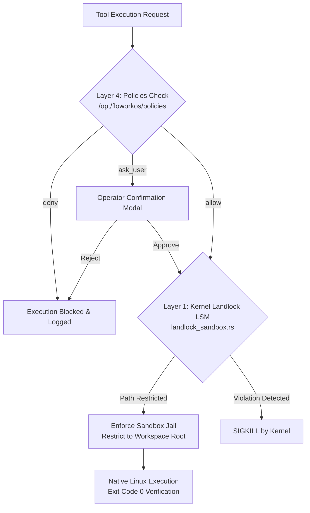

# 🏛️ Flowork OS — Master Sovereign Architecture Specification (`ARCHITECT.md`)

```text
  ███████╗██╗      ██████╗ ██╗    ██╗ ██████╗ ██████╗ ██╗  ██╗     ██████╗ ███████╗
  ██╔════╝██║     ██╔═══██╗██║    ██║██╔═══██╗██╔══██╗██║ ██╔╝    ██╔═══██╗██╔════╝
  █████╗  ██║     ██║   ██║██║ █╗ ██║██║   ██║██████╔╝█████╔╝     ██║   ██║███████╗
  ██╔══╝  ██║     ██║   ██║██║███╗██║██║   ██║██╔══██╗██╔═██╗     ██║   ██║╚════██║
  ██║     ███████╗╚██████╔╝╚███╔███╔╝╚██████╔╝██║  ██║██║  ██╗    ╚██████╔╝███████║
  ╚═╝     ╚══════╝ ╚═════╝  ╚══╝╚══╝  ╚═════╝ ╚═╝  ╚═╝╚═╝  ╚═╝     ╚═════╝ ╚══════╝
```

> **Authoritative Specification Version:** 1.0.0-SOVEREIGN  
> **Target Operating System:** Flowork OS (Rust-Integrated Sovereign Linux)  
> **Kernel Architecture:** `Linux 7.3.0-flowork-rust` (Eust Kernel Core)  
> **System Territory:** `/opt/floworkos` (Mirrored to `/home/mrflow/floworkos`)  
> **Security Baseline:** Landlock LSM + 5-Tier Policy Governance Engine  

---

## 1. Executive Vision & Core Doctrines

**Flowork OS** is an autonomous, sovereign, agent-native desktop operating system. It merges a high-performance Linux foundation—hardened by a custom **Rust-integrated kernel**—with an autonomous cognitive runtime engine (**Mr. Flow**), decoupled native tooling, declarative security policies, and sub-millisecond environmental instincts.

### The Five Invariant Doctrines
1. **Zero-Trust Sovereign Independence**: Flowork OS relies on no proprietary external ecosystems, third-party corporate preambles, or unverified upstream telemetry.
2. **Radical Non-Dualism**: *"Flowork is Linux. Linux applications are Flowork applications."* Every standard Linux binary, desktop protocol, and POSIX primitive is a native Flowork asset.
3. **Cinnamon Identity Eradication**: All legacy desktop identity is completely replaced with the bespoke Flowork Sovereign glass desktop interface.
4. **Empirical Verification (Exit Code 0)**: Every system assertion, tool invocation, and build artifact must be backed by reproducible terminal evidence with Exit Code 0.
5. **Sacred Code Locks (`@lock` & `@freez`)**: Invariant configuration files and security boundaries marked with protection tags remain strictly immutable.

---

## 2. High-Level System Architecture

Flowork OS operates as a unified six-layer vertical stack, spanning from bare-metal hardware and custom kernel modules up to autonomous subagents and the user desktop:

```mermaid
graph TD
    subgraph Layer5["Layer 5: Sovereign UI & Desktop Shell"]
        UI_DESK["Flowork Sovereign Quantum Glass Desktop & Orbit Diaphragm"]
        UI_NEMO["Nemo File Manager (11 Pinned Sovereign Bookmarks)"]
        UI_POPUP["Native Sovereign Glass Notification & Snipping Overlay"]
    end

    subgraph Layer4["Layer 4: Sovereign Modular Subsystems (The 11 Pillars)"]
        M1["📸 Screenshots (/opt/floworkos/screenshots)"]
        M2["⚡ Prompts (/opt/floworkos/system/system_promp/promps)"]
        M3["🛠️ Tools (/opt/floworkos/tools)"]
        M4["🤖 Subagents (/opt/floworkos/agents)"]
        M5["🔌 MCP Servers (/opt/floworkos/mcp)"]
        M6["⚖️ Policies (/opt/floworkos/policies)"]
        M7["💡 Skills (/opt/floworkos/skills)"]
        M8["🎯 Active Triggers (/opt/floworkos/system/triger)"]
        M9["📜 Rules & Triggers (/opt/floworkos/system/system_promp)"]
        M10["💬 Chat History (/opt/floworkos/history/chats)"]
        M11["⚡ Connector Gateway (/opt/floworkos/connector)"]
    end

    subgraph Layer3["Layer 3: Autonomous Cognitive Engine (Mr. Flow CLI)"]
        CLI_MR["Mr. Flow CLI Runtime (/usr/local/bin/mrflow)"]
        CLI_ASM["Prompt Assembler & Formula 5-3-3 Router"]
        CLI_RUST_RULES["60+ Compiled Rust Passive Rules (.bin/)"]
        CLI_ACT_WATCH["Active Trigger Watchdog (/tmp/flowork_active_trigger.json)"]
    end

    subgraph Layer2["Layer 2: Native Rust System Daemon (sysd)"]
        SYSD_CORE["Flowork sysd Native Daemon (/opt/floworkos/sysd)"]
        SYSD_CDP["CDP Headless Browser Pool (cdp_pool.rs)"]
        SYSD_IPC["UNIX Socket REST Control Plane (routes.rs)"]
        SYSD_WM["X11 & EWMH Desktop Geometry Controller (x11_ctrl.rs)"]
        SYSD_JANITOR["Scratch Buffer Janitor (scratch_janitor.rs)"]
    end

    subgraph Layer1["Layer 1: Rust-Integrated Linux Kernel (Eust Kernel)"]
        KERN["Linux Kernel 7.3.0-flowork-rust"]
        KERN_RUST["Kernel Space Rust Subsystem (Memory Safety & Zero Data Race)"]
        KERN_LANDLOCK["Landlock LSM Sandboxing (landlock_sandbox.rs)"]
        KERN_DRM["Direct Rendering Manager Capture (drm_capture.rs)"]
        KERN_UINPUT["UInput Virtual Input Device Subsystem (uinput_ctrl.rs)"]
        KERN_SURV["Kernel Telemetry & Surveillance (kernel_surveillance.rs)"]
    end

    Layer1 --> Layer2
    Layer2 --> Layer3
    Layer3 --> Layer4
    Layer4 --> Layer5
```



---

## 3. Deep Architectural Layer Breakdown

### Layer 1: Rust-Integrated Linux Kernel (`Eust Kernel`)
* **Kernel Version:** `Linux mrflow 7.3.0-flowork-rust-gd89e1d186ec9 #7 SMP PREEMPT_DYNAMIC`
* **Core Rationale:** By integrating Rust directly into kernel space, Flowork OS eliminates entire classes of memory vulnerabilities (use-after-free, double-free, null pointer dereferences, data races) at ring 0.
* **Kernel Subsystems:**
  1. **Landlock LSM Sandboxing (`landlock_sandbox.rs`)**: Enforces hardware-backed, unprivileged file path restriction rules directly inside the kernel, guaranteeing that untrusted subagents cannot escape workspace roots.
  2. **DRM Hardware Capture (`drm_capture.rs`)**: Directly maps Linux Direct Rendering Manager framebuffer memory for zero-copy, sub-frame desktop state capture without X11 overhead.
  3. **UInput Virtual Controllers (`uinput_ctrl.rs`)**: Emulates hardware-level HID input devices (keyboard, mouse, digitizer) via `/dev/uinput` for deterministic agent interaction.
  4. **Kernel Surveillance (`kernel_surveillance.rs`)**: Gathers low-overhead process lifecycle events, context switches, and page-fault metrics for anomaly detection.

---

### Layer 2: Native Rust System Daemon (`sysd`)
* **Location:** `/opt/floworkos/sysd/` (Source: `/opt/floworkos/sysd/src/`)
* **Binary Target:** `/opt/floworkos/sysd/target/release/sysd`
* **Responsibilities:**
  - **CDP Session Pool (`cdp_pool.rs`)**: Pre-warms and coordinates headless Chrome DevTools Protocol instances, sharing memory buffers between visual inspector tools.
  - **Local UNIX IPC Plane (`routes.rs`)**: Provides a zero-latency UNIX domain socket REST/JSON API for agent tools, desktop widgets, and status monitors.
  - **Window & Geometry Control (`x11_ctrl.rs` & `sidebar_geometry.rs`)**: Directly talks to X11/EWMH to snap windows, enforce sidebar dock geometries, and control application placement.
  - **Scratch Janitor (`scratch_janitor.rs`)**: Automatically cleans up orphaned test buffers, temporary execution artifacts, and expired IPC payloads in `.flowork/` to prevent disk bloat.

---

### Layer 3: Autonomous Cognitive Engine (Mr. Flow CLI)
* **Executable:** `/usr/local/bin/mrflow` -> `/opt/floworkos/bin/mrflow` (Clean-room Native Rust crate: `/opt/floworkos/mrflow-rs/`)
* **Assembly Core:** `/opt/floworkos/system/system_promp/promps/engine.js`
* **Dynamic Context Router:** `/opt/floworkos/system/system_promp/promps/router.js`
* **Architecture:**
  - **Formula 5-3-3 Dynamic Sliding Window**: Dynamically allocates context tokens:
    - **5 Top Modules**: Preamble, active mandates, core guidelines, tool manifests, workspace context.
    - **3 Reactive Instincts**: Real-time environmental triggers injected on demand.
    - **3 Episodic Memory Frames**: Most recent interaction turns.
  - **Native Rust Passive Rule Evaluator**: Executes over 60+ compiled Rust binaries in `/opt/floworkos/system/system_promp/rules/.bin/` within `< 2ms` per turn, assessing git status, system load, network availability, and project structure without shell execution overhead.
  - **Active Trigger Watchdog**: Continuously monitors background daemons via `/tmp/flowork_active_trigger.json`, instantly waking the agent on critical environmental shifts.

---

### Layer 2.5: Sovereign Inference & Quota Gateway (Connector Subsystem :9099)
* **Location:** `/opt/floworkos/connector/` (Binary: `bin/connector`)
* **Runtime Profile:** Self-contained Bun ELF standalone sealed binary running with zero external package dependencies.
* **Endpoint & Protocol:** `http://127.0.0.1:9099/` with full OpenAI-compatible API translation (`/v1/chat/completions`).
* **Architecture & Resilience:**
  - **Dynamic Multi-Account Quota Rotator**: Rotates OAuth refresh tokens across Google CloudCode pools with intelligent 429 exponential backoff, shielding the operating system from token starvation.
  - **Single Model Lock Doctrine**: Enforces standard inference payloads dynamically mapped to `gemini-3.8-flash-high` to prevent invalid model errors and maximize response throughput.
  - **Multi-Provider Failover Matrix**: Provides seamless live switching between Google CloudCode, local Ollama GPU clusters (`http://localhost:11434`), and universal 9Router gateway.
  - **Zero-Hardcode Configuration**: Dynamic token management via `/opt/floworkos/connector/config/accounts.json` with embedded web GUI controller (`:9099/gui`).

---

## 4. The 11 Canonical Sovereign Pillars (Detailed Specifications)

Flowork OS organizes all agent resources into eleven modular, decoupled pillars accessible via the filesystem and pinned into the Nemo sidebar bookmarks:

```text
/opt/floworkos/
├── connector/                 <-- ⚡ Connector Gateway (:9099)
├── screenshots/               <-- 📸 Screenshots Vault
├── system/
│   ├── system_promp/
│   │   ├── promps/            <-- ⚡ Master System Prompts
│   │   ├── rules/             <-- 📜 Rules & Triggers (Compiled Rust)
│   │   └── triggers.json
│   └── triger/                <-- 🎯 Active Trigger Daemons
├── tools/                     <-- 🛠️ Decoupled Tools Registry
├── agents/                    <-- 🤖 Subagents Ecosystem
├── mcp/                       <-- 🔌 Model Context Protocol Servers
├── policies/                  <-- ⚖️ 5-Tier Security Policies
├── skills/                    <-- 💡 20-Keyword Knowledge Skills
└── history/
    └── chats/                 <-- 💬 Episodic Chat History Vault
```

### Complete Cross-Reference Table

| # | Icon & Module | Canonical Path | Authoritative Documentation | Primary Architectural Function |
| :-: | :--- | :--- | :--- | :--- |
| **1** | **📸 Screenshots** | `/opt/floworkos/screenshots` | [README.md](file:///opt/floworkos/screenshots/README.md) | Universal visual capture vault; stores all headless browser dumps, CLI snips, and desktop screenshots. |
| **2** | **⚡ Prompts** | `/opt/floworkos/system/system_promp/promps` | [README.md](file:///opt/floworkos/system/system_promp/promps/README.md) | Canonical system prompt storage; houses preamble, operational guidelines, and Formula 5-3-3 prompt assembler. |
| **3** | **🛠️ Tools** | `/opt/floworkos/tools` | [README.md](file:///opt/floworkos/tools/README.md) | Decoupled standalone tools engine; zero hardcoded CLI binary tools; dynamic discovery (`discovery.js`) and execution (`executor.js`). |
| **4** | **🤖 Subagents** | `/opt/floworkos/agents` | [README.md](file:///opt/floworkos/agents/README.md) | Subagent ecosystem; enforces mandatory `goal` and `golden_rules` schema, isolated sub-turn execution, and flat 1-level hierarchy. |
| **5** | **🔌 MCP Servers** | `/opt/floworkos/mcp` | [README.md](file:///opt/floworkos/mcp/README.md) | Model Context Protocol integration hub; clean stdio IPC isolation; decoupled from native tools. |
| **6** | **⚖️ Policies** | `/opt/floworkos/policies` | [README.md](file:///opt/floworkos/policies/README.md) | 5-tier security governance engine (`allow`, `ask_user`, `deny`); 100% dynamic TOML evaluation on-disk without recompilation. |
| **7** | **💡 Skills** | `/opt/floworkos/skills` | [README.md](file:///opt/floworkos/skills/README.md) | Procedural SOP knowledge repository; strictly enforced with YAML frontmatter containing **exactly 20 English keywords**. |
| **8** | **🎯 Active Triggers** | `/opt/floworkos/system/triger` | [README.md](file:///opt/floworkos/system/triger/README.md) | Asynchronous background daemon supervisors writing high-priority environmental alerts to `/tmp/flowork_active_trigger.json`. |
| **9** | **📜 Rules & Triggers** | `/opt/floworkos/system/system_promp` | [README.md](file:///opt/floworkos/system/system_promp/README.md) | Master prompt hub & 60+ native compiled Rust rule checkers in `rules/.bin/` linking environmental state to prompt injection. |
| **10** | **💬 Chat History** | `/opt/floworkos/history/chats` | [README.md](file:///opt/floworkos/history/chats/README.md) | Canonical streaming JSONL transcript repository partitioned by workspace namespaces for persistent `--resume` state. |
| **11** | **⚡ Connector** | `/opt/floworkos/connector` | [README.md](file:///opt/floworkos/connector/README.md) | High-performance inference proxy (:9099), multi-account quota shield, and provider routing matrix. |

---

## 5. Security Architecture & Landlock Sandboxing

Security in Flowork OS is multi-layered, combining hardware, kernel, and cognitive enforcement:



1. **Policy Filter (Userspace)**: Evaluates the operation against `/opt/floworkos/policies/*.toml`. Five tiers (`Admin > User > Workspace > Extension > Default`) resolve the decision (`allow`, `ask_user`, `deny`).
2. **Landlock LSM Jail (Kernel Space)**: Applied via `landlock_sandbox.rs` in `sysd`. Restricts file write and execute permissions exclusively to declared workspace directories, rendering arbitrary system tampering physically impossible.
3. **Subagent Scope Isolation**: Subagents are strictly prohibited from spawning secondary subagents (flat 1-level limit) and only possess access to the tools declared in their frontmatter.

---

## 6. IPC Fabrics & Telemetry Data Paths

Flowork OS utilizes five distinct high-speed communication fabrics to maintain sub-millisecond responsiveness:

1. **Active Trigger Shared IPC Buffer (`/tmp/flowork_active_trigger.json`)**:
   - Monitored by the CLI watchdog.
   - Background supervisors write atomic JSON updates when system conditions warrant immediate agent interruption.
2. **UNIX Domain Socket REST Bus (`sysd`)**:
   - Local IPC endpoint `/tmp/sysd.sock` provides bidirectional binary streaming between GUI widgets, desktop geometry controllers, and the native Rust daemon.
3. **Stdio Protocol Streams (MCP)**:
   - Line-delimited JSON-RPC over `stdin`/`stdout`.
   - Logging and non-protocol output are redirected strictly to `stderr` to avoid JSON frame corruption.
4. **Fast-Path Rust Rules Binary Spawning**:
   - Sub-millisecond synchronous process evaluation via `rules/.bin/<rule_name>`.
   - Returns instantaneous exit codes (`0` for trigger active, `1` for trigger inactive) directly into prompt assembly.
5. **Sovereign Connector Gateway Stream Fabric (:9099)**:
   - High-throughput local HTTP/SSE streaming connection (`http://127.0.0.1:9099/v1/chat/completions`).
   - Bridges the Mr. Flow cognitive engine with external LLM inference providers while shielding the operating system from quota starvation.

---

## 7. Desktop Integration & ISO Deployment Standards

### Multi-User Zero-Drift Design
To ensure that Flowork OS builds into an installation ISO with **Zero Broken Paths**:
- **System Assets are Global**: Everything resides in `/opt/floworkos/`. No hardcoded `/home/awenkaudico` or `/home/mrflow` exists in system configs.
- **Universal Write Access**: Directories designed for runtime agent outputs (`/opt/floworkos/screenshots/` and `/opt/floworkos/history/chats/`) are configured with `chmod 777` permissions.
- **Skel Template Synchronization**: `/etc/skel/.config/gtk-3.0/bookmarks` contains exact mirrors of all 11 sovereign bookmarks, ensuring any newly provisioned user immediately receives the full Flowork desktop environment.

### Flowork Sovereign Glass HUD Specification (Overlay Working Standard)
Flowork OS enforces a dedicated multitasking transparent overlay standard ([glass_hud_spec.md](file:///opt/floworkos/system/glass_hud_spec.md)) allowing operators to work, code, and chat with Mr. Flow while seamlessly viewing underlying media (such as YouTube videos, documentation, or IDE sessions) without visual blockage:
- **Translucency & Opacity:** 40% see-through transparency (`window.opacity = 0.60`, 32-bit ARGB `alpha = 153/255`), providing an optimal obsidian contrast floor so bright background media or white web pages do not wash out terminal text.
- **Neutral Optical Glass:** Pure neutral obsidian base (`#000000`). Zero artificial blue (`#07263d`) or grey (`#0c131f`) paint, preserving 100% natural color fidelity of background video.
- **Full Cell Passthrough:** `colors.transparent_background_colors = true` prevents ANSI/TUI cell blocks from obstructing background content.
- **Polar-Opposite Contrast:** Pure Crystal White (`#ffffff`) for all primary & secondary text paired with JetBrains Mono **Bold** weight (12.0pt), guaranteeing razor-sharp, non-faint legibility over bright YouTube pages and dynamic video scenes alike.
- **Clean Prompt & Focus Accent:** Razor Matrix Green (`#00ff66`) prompt symbol `> ` and white cursor (`#ffffff`).
- **Seamless Floating Prompt:** Eliminates opaque input box backgrounds, floating prompts natively above the glass layer.

---

## 8. Master Summary: The Sovereign Flowork Machine

```text
┌────────────────────────────────────────────────────────────────────────┐
│                        FLOWORK OS KERNEL (Rust)                        │
│                 Linux 7.3.0-flowork-rust (Eust Kernel)                 │
│         [Landlock LSM] [DRM Framebuffer] [UInput HID] [Sysd]           │
└───────────────────────────────────┬────────────────────────────────────┘
                                    │
┌───────────────────────────────────▼────────────────────────────────────┐
│                  MR. FLOW AUTONOMOUS COGNITIVE ENGINE                  │
│       Prompt Assembler | Formula 5-3-3 Router | 60+ Rust Rules         │
└───────────────────────────────────┬────────────────────────────────────┘
                                    │
┌───────────────────────────────────▼────────────────────────────────────┐
│                 THE 11 MODULAR SOVEREIGN PILLARS                       │
│  [Connector]   [Screenshots] [Prompts] [Tools] [Agents] [MCP]          │
│  [Policies]    [Skills]      [Triggers] [Rules] [Chat History]         │
└───────────────────────────────────┬────────────────────────────────────┘
                                    │
┌───────────────────────────────────▼────────────────────────────────────┐
│                   FLOWORK SOVEREIGN DESKTOP SHELL                      │
│   Flowork Sovereign Quantum Glass UI | Orbit Diaphragm | Nemo Vault    │
└────────────────────────────────────────────────────────────────────────┘
```

*Flowork OS — Autonomous, Memory-Safe, Sovereign Computing.*
