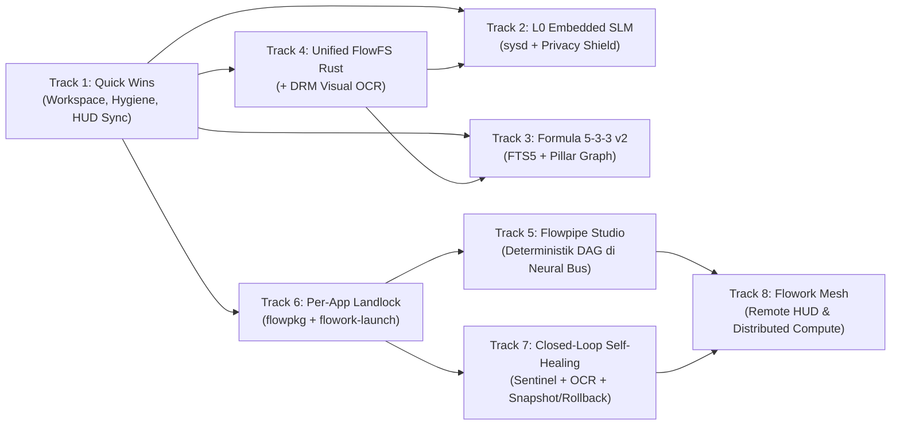

# 🗺️ FLOWORK OS — MASTER DEVELOPMENT ROADMAP (TRACK 1 – 8)

> **Dokumen:** Rencana Pengembangan Arsitektur & Eksekusi Terperinci  
> **Tanggal Audit:** 12 November 2026  
> **Target Sistem:** `/opt/floworkos` (`Linux 7.3.0-flowork-rust-v2`)  
> **Basis Audit Empiris:** `mrflow-rs`, `sysd`, `connector-rs`, `crates/flowork-core-rs`, `wm`, `session/`, `policies/`, `apps/`, `skills/`, `system/system_promp/`, `docs/roadmap.md`, `.fl_brain/roadmap.md`

---

## 📌 Ringkasan Eksekutif & Peta Ketergantungan (Dependency Graph)

Flowork OS telah memiliki fondasi yang kuat: kernel `7.3.0-flowork-rust-v2`, kontrol hardware & X11 via `flowork-sysd` (`:18090`), inference proxy multi-akun via `flowork-connector` (`:9099`), event fabric `flowork-neural-bus` (`:18095` / `bus.sock`), serta mesin kognitif tanpa-bloat `mrflow-rs` (`Formula533Router`, 78 Rust rules / 83 ELF binary di `rules/.bin/`, dan SQLite FTS5 `episodic_memory.db`).

Namun audit langsung menemukan **kesenjangan antara arsitektur target dan implementasi aktual**:
- Crate Rust terpisah tanpa root workspace & gagal dicek dengan `cargo 1.75.0` bawaan sistem.
- `sysd/src/embedded_slm.rs` masih berupa *string-matching router* (belum ada runtime SLM/GGUF nyata; `/opt/floworkos/models/` kosong).
- `flowpkg run` & `flowork-launch` belum mengeksekusi syscall Landlock LSM yang sebenarnya (baru sanitasi env & cetak label).
- `flowfs_core.py` masih berjalan di Python+NumPy secara terpisah dari FTS5 Rust di `mrflow-rs`, dan belum memiliki pipeline OCR layar otomatis.
- Masih ada service systemd yatim (*broken units*), dual tray applet, serta drift konfigurasi Alacritty terhadap `glass_hud_spec.md`.



### Matriks Prioritas Eksekusi

| Track | Judul Pengembangan | Fase | Estimasi | Dampak Utama | Prasyarat |
| :---: | :--- | :---: | :---: | :--- | :--- |
| **1** | Unifikasi Build Rust, Hygiene Systemd & Zero-Drift | Sprint A | 1–2 Hari | CI/test 1 perintah, boot bersih, HUD patuh spec | — |
| **2** | Upgrade `embedded_slm.rs` → L0 Router & Privacy Shield | Sprint B | 4–6 Hari | Hemat kuota cloud, mode offline nyata, proteksi PII | Track 1 |
| **3** | Evolusi `Formula533Router` (Hybrid FTS5 + Pillar Graph) | Sprint B | 2–3 Hari | Recall skill/tool jauh lebih akurat untuk bahasa natural | Track 1 |
| **4** | Unified FlowFS Pure Rust + Visual OCR Screen Memory | Sprint C | 4–5 Hari | Hapus NumPy/Python daemon, Spotlight `?` cari teks di layar | Track 1 |
| **5** | Flowpipe Studio (Makro DAG Deterministik di Neural Bus) | Sprint C | 3–5 Hari | Otomasi lintas 18+ app studio dengan 0 token LLM saat replay | Track 1, 6 |
| **6** | Per-App Landlock Capability Manifest (`flowpkg` + `launch`) | Sprint B | 2–4 Hari | App buatan AI (`craft-anything`/`remix`) terkunci di kernel | Track 1 |
| **7** | Closed-Loop Self-Healing (`sentinel` + `ocr` + `snapshot`) | Sprint D | 4–6 Hari | Crash otomatis terisolasi, patch teruji, auto-rollback aman | Track 1, 6 |
| **8** | Flowork Mesh (Remote HUD & Distributed Compute) | Sprint E | 7–10 Hari | Offload render/LLM dari laptop tipis ke workstation GPU | Track 5, 6, 7 |

---

## 🔧 TRACK 1: Quick Wins — Unifikasi Build Rust, Hygiene Systemd & Zero-Drift

### 1.1 Audit Kondisi Saat Ini (Baseline Empiris)
1. **Fragmentasi Cargo & Toolchain Mismatch:**
   - Crate terpisah di `/opt/floworkos/crates/flowork-core-rs`, `/opt/floworkos/mrflow-rs`, `/opt/floworkos/connector-rs`, `/opt/floworkos/sysd`, dan `/opt/floworkos/wm`.
   - Tidak ada root `/opt/floworkos/Cargo.toml` (`[workspace]`).
   - Host menggunakan `cargo 1.75.0` / `rustc 1.75.0`, sedangkan lockfile `flowork-core-rs`, `mrflow-rs`, dan `connector-rs` memakai `version = 4`, dan `sysd` menarik crate dengan `edition2024`. Akibatnya `cargo check` / `cargo test` lokal gagal.
2. **Inconsistency Path Binary:**
   - `flowork-connector` berada di `/opt/floworkos/connector/bin/flowork-connector`, belum ada symlink di `/opt/floworkos/bin/flowork-connector`.
3. **Service Systemd Yatim & Duplikat (`/etc/systemd/user/`):**
   - `flowork-visiond.service` memanggil `/opt/floworkos/daemon/flowork_visiond.py` (direktori `daemon/` dan file tidak ada) dan `WorkingDirectory=%h/floworkos`.
   - `flowork-window-manager.service` memanggil `/usr/local/bin/flowork-window-daemon` (tidak ada) dan `WorkingDirectory=%h/floworkos`.
   - Dua service tray aktif bersamaan: `mrflow-tray.service` (`/usr/local/bin/mrflow-tray-menu`) dan `flowork-mrflow-tray-applet.service` (`/usr/local/bin/mrflow-tray-applet`).
   - `wm/` (`flowork-wm`) masih prototipe yang belum dikompilasi/terhubung dengan `flowork-session.sh` (masih menjalankan `xfwm4`), sementara `flowork-wm.service` tetap ada di `/etc/systemd/user/`.
4. **Drift Doktrin & HUD Spec:**
   - `/opt/floworkos/session/flowork-session.sh` (baris 298–341) menulis `alacritty.toml` dengan `opacity = 0.90`, `background = "#131a28"`, `font.size = 11.0`, `style = "Regular"`, dan tanpa `transparent_background_colors = true`—bertentangan dengan `@lock` `/opt/floworkos/system/glass_hud_spec.md` (`opacity = 0.60`, `#000000`, `JetBrains Mono Bold 12.0`, `transparent_background_colors = true`, prompt `#00ff66`).
   - `/opt/floworkos/system/system_promp/promps/01_core_mandates.md` (baris 34) masih memuat kalimat Bahasa Indonesia (`HARAM PERSISTENT BLOAT: DILARANG KERAS...`), melanggar aturan 100% Technical English di `promps/README.md`.
   - File UI lawas di `/opt/floworkos/theme/` (`flowork-launchpad.py`, `spotlight.rasi`, `launchpad.rasi`) belum dibersihkan/diarsipkan setelah digantikan `flowork-orbit.py`.

### 1.2 Rencana Implementasi Detail
- **Langkah 1.A — Root Cargo Workspace & Toolchain Pinning:**
  - Install/register Rust toolchain modern (`rustup` stable `>= 1.84.0`) dan tambahkan `/opt/floworkos/rust-toolchain.toml`.
  - Buat `/opt/floworkos/Cargo.toml` berisi:
    ```toml
    [workspace]
    resolver = "2"
    members = [
        "crates/flowork-core-rs",
        "mrflow-rs",
        "connector-rs",
        "sysd",
        "wm",
    ]
    ```
  - Samakan versi dependency bersama di `[workspace.dependencies]` (`tokio`, `axum`, `serde`, `serde_json`, `rusqlite`, `reqwest`, `x11rb`) untuk memangkas waktu kompilasi dan ukuran binary.
  - Tambah symlink `/opt/floworkos/bin/flowork-connector -> /opt/floworkos/connector/bin/flowork-connector`.
- **Langkah 1.B — Pembersihan & Konsolidasi Systemd User Units:**
  - Audit seluruh unit di `/etc/systemd/user/`, `/etc/skel/.config/systemd/user/`, dan `$HOME/.config/systemd/user/` beserta referensinya di `iso-builder/build-live-iso.sh` dan `session/install-session.sh`.
  - Hapus atau nonaktifkan unit yatim: `flowork-visiond.service` dan `flowork-window-manager.service` (fiturnya sudah digantikan oleh `flowork-sysd` & `flowork-neural-bus`).
  - Putuskan dan gabungkan tray applet menjadi satu unit kanonik (`flowork-mrflow-tray-applet.service` jika menggunakan sidebar companion terbaru, atau sinkronkan menu connector + sidebar ke satu ikon tray saja).
  - Sinkronkan `flowork-wm.service` agar berstatus manual/experimental atau jadikan build target resmi di workspace jika siap menggantikan `xfwm4`.
- **Langkah 1.C — Sinkronisasi Glass HUD & Dokumentasi:**
  - Perbarui blok `EOF_ALACRITTY` di `/opt/floworkos/session/flowork-session.sh` (baris 297–371) dan `/etc/skel/.config/alacritty/alacritty.toml` agar **100% identik** dengan `/opt/floworkos/system/glass_hud_spec.md` (Section 3).
  - Pindahkan legacy `spotlight.rasi`, `launchpad.rasi`, `flowork-launchpad.py` ke `theme/_legacy/` (atau hapus setelah verifikasi tidak ada shortcut aktif yang menunjuk ke sana).
  - *Catatan `@lock`:* Untuk `01_core_mandates.md` baris 34, karena berstatus `@lock`, lakukan audit persetujuan eksplisit sebelum mengubah 1 baris bahasa tersebut ke Technical English agar selaras dengan `promps/README.md` tanpa melanggar proteksi lock.

### 1.3 Acceptance Criteria & Verifikasi
```bash
# 1. Workspace build & unit tests lolos
cd /opt/floworkos && cargo check --workspace && cargo test --workspace

# 2. Symlink connector valid
readlink -f /opt/floworkos/bin/flowork-connector && /opt/floworkos/bin/flowork-connector --help

# 3. Tidak ada systemd unit yatim atau failed
systemctl --user daemon-reload
systemctl --user list-units --state=failed --no-pager

# 4. Verifikasi config Alacritty sesuai glass_hud_spec.md
grep -E "opacity = 0\.60|background = \"#000000\"|transparent_background_colors = true" /etc/skel/.config/alacritty/alacritty.toml
```

### 1.4 Risiko & Mitigasi
- **Risiko:** Menyatukan `Cargo.toml` mengubah default `target/` directory saat `build` dijalankan dari sub-direktori.
- **Mitigasi:** Update skrip build/OTA (`upload-flowork-os.sh` & `flowork-manifest-gen`) agar membaca output dari `/opt/floworkos/target/release/` dan menyalin binary ke `/opt/floworkos/bin/`.

---

## 🧠 TRACK 2: Upgrade `embedded_slm.rs` → "L0 Cognitive Router & Privacy Shield"

### 2.1 Audit Kondisi Saat Ini
- `/opt/floworkos/sysd/src/embedded_slm.rs` (167 baris) saat ini **hanya `if p_lower.contains(...)`** untuk 5 intent hardcoded (`remix`, `cari layar`, `cari file`, `cek sistem`, `buka `).
- `/opt/floworkos/models/` kosong (belum ada model GGUF/Safetensors).
- `/opt/floworkos/sysd/Cargo.toml` belum memiliki feature flag atau crate inferensi lokal (`llama-cpp-2` / `candle`).
- `/opt/floworkos/bin/flowork-slm` masih berupa wrapper Python terpisah.

### 2.2 Target Arsitektur (L0 Always-Active Cognitive Layer)
Alih-alih hanya aktif saat internet putus, `EmbeddedSlmEngine` dijadikan **otak lapis nol (L0)** di dalam `flowork-sysd` (`:18090/v1/chat/completions`):

```text
User Prompt / Agent Pre-Turn
  │
  ▼
[L0 Embedded SLM in flowork-sysd (:18090)]  (Qwen2.5-Coder-1.5B-Instruct Q4_K_M / Qwen3-0.6B)
  ├─ [Role A] Fast OS Triage (<300ms, 0 Cloud Quota)
  │     └─ Deteksi intent lokal: launch app, window tile, audio, FlowFS search, health check
  │        └─ Output JSON terstruktur -> eksekusi langsung via sysd/Landlock!
  ├─ [Role B] Bilingual Intent Normalizer -> Formula533Router
  │     └─ Ubah "tolong rapihin audio podcast biar jernih" -> keywords: ["audio", "mastering", "kamidi", "eq", "noise"]
  └─ [Role C] Pre-Egress Privacy & Secret Shield (sebelum keluar ke :9099 CloudCode)
        └─ Masking token, private key, jalur sensitif, & PII sebelum dikirim ke cloud
```

### 2.3 Rencana Implementasi Detail
- **Langkah 2.A — Integrasi Engine Inferensi Rust di `sysd`:**
  - Tambah Cargo feature `embedded-slm` di `/opt/floworkos/sysd/Cargo.toml` menggunakan `llama-cpp-2` (mendukung `mmap` startup `<150ms`, CPU AVX2, dan opsional backend Vulkan/CUDA tanpa wajib Nvidia).
  - Buat model manager di `sysd/src/slm_loader.rs`:
    - Lazy-load dengan `OnceLock` + idle unload timer (misal unload setelah 10 menit tidak dipakai jika RAM < 2GB tersedia, agar footprint RAM tetap rendah di mesin ringan).
    - Lokasi model standar: `/opt/floworkos/models/l0-router.gguf` (plus fallback ke `/opt/floworkos/models/*.gguf` atau graceful degradation ke fast heuristic bila file GGUF belum diunduh).
- **Langkah 2.B — Grammar-Constrained Structured JSON Output:**
  - Terapkan JSON schema/GBNF grammar pada L0 SLM sehingga output intent router **100% valid JSON**:
    ```json
    {
      "route": "local_action | delegate_cloud",
      "confidence": 0.92,
      "intent": "flowfs_screen_search",
      "args": { "query": "rust borrow checker error" },
      "normalized_keywords": ["rust", "borrow", "compiler", "debug"]
    }
    ```
  - Jika `route == "local_action"` dan `confidence >= 0.85`, `sysd` mengeksekusi tool lokal secara langsung tanpa menyentuh kuota Google CloudCode di `:9099`.
- **Langkah 2.C — Pre-Egress Privacy Shield Middleware:**
  - Tambahkan endpoint internal `POST /api/agent/privacy/redact` di `sysd/src/routes.rs` dan panggil dari `connector-rs/src/proxy.rs` (opsi toggle di `connector/config/settings.json`).
  - Kombinasikan *deterministic regex scanner* (API keys, JWT, PEM, IP privat) dengan klasifikasi L0 SLM untuk mendeteksi kredensial kontekstual sebelum prompt diteruskan keluar ke internet.
- **Langkah 2.D — Integrasi Air-Gapped Failover & Deprecate Python `flowork-slm`:**
  - Di `connector-rs/src/providers.rs`: jika semua akun CloudCode kena HTTP `429`/timeout dan Ollama `:11434` tidak aktif, otomatis failover ke `http://127.0.0.1:18090/v1/chat/completions`.
  - Jadikan `/opt/floworkos/bin/flowork-slm` thin wrapper ke endpoint `:18090` (atau CLI subcommand di `mrflow`) dan perbarui `iso-builder` agar menyediakan skrip download model on-demand (`flowork-slm --pull-model`) sehingga ukuran ISO tetap ramping.

### 2.4 Acceptance Criteria & Verifikasi
```bash
# 1. Uji local fast triage tanpa internet (simulasi interface offline / mock offline)
curl -s http://127.0.0.1:18090/v1/chat/completions \
  -H "Content-Type: application/json" \
  -d '{"model":"l0-router","messages":[{"role":"user","content":"cari tangkapan layar error cargo tadi pagi"}]}' | jq .

# 2. Pastikan latency < 500ms pada intent lokal dan menghasilkan normalized_keywords valid
# 3. Uji Privacy Shield: kirim string berisi "Bearer ya29.test_secret_token" -> terdeteksi/ter-redact sebelum outbound proxy
```

### 2.5 Risiko & Mitigasi
- **Risiko:** Membebani RAM/CPU pada perangkat spek rendah (<8 GB RAM) atau membengkakkan ukuran ISO (+1.1 GB).
- **Mitigasi:** Jangan bundle `.gguf` ke dalam SquashFS ISO; sediakan model ultra-ringan (~450 MB Q4 `0.6B`/`1.5B`) via installer pasca-boot + *memory-pressure guard* (otomatis nonaktifkan model jika `MemAvailable < 1200 MB`).

---

## 🎯 TRACK 3: Evolusi `Formula533Router` — Hybrid FTS5 + Cross-Pillar Dependency Graph

### 3.1 Audit Kondisi Saat Ini
- `Formula533Router` di `/opt/floworkos/mrflow-rs/src/cognitive/mod.rs` (baris 1018–1157) melakukan scoring murni via irisan `HashSet<String>` (`score = jumlah token cocok * 5`, threshold `>= 10` yaitu minimal **2 kecocokan kata persis**; kata `<3` karakter dibuang).
- Dampak nyata:
  1. Jika user menulis bahasa Indonesia atau sinonim (*"bikin video pendek"*, *"cek kerentanan web"*, *"kompres audio"*), dan manifest hanya berisi keyword Inggris spesifik (`"animation"`, `"vulnerability"`, `"mastering"`), skor bisa `< 10` sehingga skill/tool yang relevan tidak terinjeksi.
  2. Tidak ada relasi struktural antar pilar (mis. ketika skill `kamidi-mastering` aktif, tool `earshot` atau CLI `kamidi-mastering-cli` tidak otomatis mendapat prioritas bobot).
  3. Tidak ada logging hit/miss router untuk mengoptimalkan keyword manifest dari waktu ke waktu.

### 3.2 Target Arsitektur Router v2
```text
Intercept Gate (keywords, goal, reason) + SniffedContext (CWD, Active App)
  │
  ├─► [Layer 1] Exact & Stemmed Token Match (bobot 5/hit, existing fast path)
  ├─► [Layer 2] In-Memory SQLite FTS5 BM25 + Synonym Aliases (bobot 3-4/hit)
  └─► [Layer 3] Cross-Pillar Affinity Graph Boost (+6 s.d. +8 poin)
        (e.g. App "cutvii" -> boost tools: cutvii_render, earshot, ffmpeg; trigger: video_pipeline)
  │
  ▼
Top 5 Tools  |  Top 3 Skills  |  Top 3 Conditional Prompts (Deduped + Lifecycle Carryover)
```

### 3.3 Rencana Implementasi Detail
- **Langkah 3.A — Synonym & Bilingual Alias Table:**
  - Buat file konfigurasi ringan `/opt/floworkos/system/system_promp/router_aliases.json` (bisa di-hot-reload tanpa recompile `mrflow`), memetakan istilah umum/Indonesia/slang ke kanonik token Inggris (`"suara|musik|lagu|audio" -> ["audio","sound","mastering","dsp"]`, `"gambar|foto|edit" -> ["image","photo","vector","render"]`, dll.).
  - Tambahkan juga *lightweight suffix stemmer* di `mrflow-rs/src/cognitive/mod.rs` (`running -> run`, `editing -> edit`, `containers -> container`) agar `tokenize_set` lebih toleran tanpa menambah dependency berat.
- **Langkah 3.B — In-Memory FTS5 Index (`rusqlite` yang sudah ada di `mrflow-rs`):**
  - Saat `Formula533Router::build` dijalankan sekali di startup sesi, indeks seluruh **78 tools**, **14+ skills**, dan **60+ conditional triggers** ke `:memory:` SQLite FTS5 (`tokenize='porter unicode61'`), menyimpan `id`, `kind`, `keywords`, dan `description`.
  - Gunakan hasil BM25 ter-normalisasi sebagai skor tambahan ketika skor exact-token `< 10`, sambil tetap mempertahankan batas ketat Top 5 / Top 3 / Top 3 (Zero-Bloat Invariant).
- **Langkah 3.C — Cross-Pillar Affinity Graph:**
  - Definisikan relasi graf ringan di `/opt/floworkos/system/system_promp/pillar_graph.json` (atau field opsional `related_tools` / `related_skills` di `triggers.json` & `SKILL.md` frontmatter).
  - Saat satu skill diaktifkan (`activate_skill`), atau saat `sniff_context` mendeteksi direktori app tertentu (mis. `/opt/floworkos/apps/cutvii`), semua node bertetangga di graf otomatis mendapat *affinity bonus* pada turn tersebut.
- **Langkah 3.D — Telemetry Hit/Miss (`router_telemetry`):**
  - Rekam skor kandidat & apakah tool yang direkomendasikan benar-benar dipanggil oleh agen di turn berikutnya ke SQLite lokal (`/opt/floworkos/history/router_metrics.db`), lengkap dengan perintah `mrflow --router-audit` untuk mendeteksi *dead triggers* (tidak pernah ter-trigger) atau *noisy triggers* (sering terinjeksi tapi diabaikan).

### 3.4 Acceptance Criteria & Verifikasi
```bash
# 1. Unit test baru di mrflow-rs untuk sinonim, stemming, dan graph affinity boost
cd /opt/floworkos && cargo test -p mrflow-rs cognitive::tests

# 2. Simulasi CLI prompt berbahasa campuran/sinonim dan audit output injeksi router
mrflow --dry-run-route "tolong bersihin noise rekaman suara podcast"
# Harus memunculkan skill/tool audio (kamidi-mastering / earshot) dengan 0 bloat prompt lain
```

### 3.5 Risiko & Mitigasi
- **Risiko:** Matching terlalu longgar membuat prompt yang tidak relevan ikut masuk (melanggar Zero-Bloat Doctrine).
- **Mitigasi:** Pertahankan hard cap `5-3-3` dan pisahkan threshold minimum untuk Layer 2 (BM25 + alias wajib minimal 2 sinyal independen, tetap dedup per sesi via `emitted_prompt_ids`).

---

## 👁️ TRACK 4: Unified "FlowFS" Pure Rust + Visual OCR Screen Memory

### 4.1 Audit Kondisi Saat Ini
- `/opt/floworkos/connector/flowfs_core.py` & `/opt/floworkos/bin/flowfs-indexer-daemon` masih berjalan di Python + NumPy, menggunakan tabel `flow_documents` dan `flow_screen_memory` dengan *hash-projected vectors*.
- Sementara itu, `mrflow-rs/src/memory/episodic.rs` sudah memakai `rusqlite` FTS5 + WAL berkecepatan tinggi di Rust.
- Di `flowfs_core.py`, fungsi `index_screen_capture(screenshot_path, window_title="", app_class="", text="")` menerima parameter `text=""` kosong—artinya **belum ada ekstraksi OCR otomatis** terhadap isi teks pada tangkapan layar/frame DRM, dan thumbnail WebP + UI `?` di Orbit Spotlight (`apps/` / `theme/flowork-orbit.py`) belum terhubung penuh sesuai spesifikasi Pillar 2 `.fl_brain/roadmap.md`.

### 4.2 Target Arsitektur Unified FlowFS
```text
[Sumber 1: Filesystem Watcher / Background Governor (<2% CPU, nice +19, ionice idle)]
[Sumber 2: Ambient Eye (Super+Shift+A) / DRM SHM (/dev/shm/flowork_drm_latest.bgra)]
         │
         ├──► Thumbnail Generator (320px WebP -> /opt/floworkos/screenshots/thumbs/<sha256>.webp)
         └──► Local OCR Extractor (ocrs / tesseract -> screen text + X11 window_title + app_class)
         │
         ▼
[crates/flowork-core-rs/src/flowfs.rs -> Unified SQLite + FTS5 + Quantized Vector Store]
         ├──► CLI: flowork-flowfs / flowfs-search --screen "<query>" --json (<25ms)
         ├──► Orbit Spotlight (Ctrl+Space): prefix "?" -> Grid Thumbnail + Lightbox
         └──► Mr. Flow JIT Recall: recall screen memory + file docs + episodic memory dalam 1 engine!
```

### 4.3 Rencana Implementasi Detail
- **Langkah 4.A — Porting `flowfs_core.py` ke `crates/flowork-core-rs/src/flowfs.rs`:**
  - Bangun modul Rust murni yang membaca/menulis skema SQLite yang kompatibel dengan database FlowFS yang ada (lakukan migrasi skema non-destruktif untuk menambah tabel virtual FTS5 `flow_documents_fts` dan `flow_screen_fts`).
  - Implementasikan *hybrid scoring*: gabungan `BM25` FTS5 + *sub-word n-gram cosine similarity* (menggantikan NumPy tanpa perlu dependensi Python atau PyTorch raksasa).
  - Buat dua subcommand/binary di `flowork-core-rs`: `flowfs-search` (CLI query `<25ms`) dan `flowfs-indexer-daemon` (Pure Rust daemon dengan `sched_setscheduler` / `nice(19)` + `ioprio_set` idle + pemantau `/proc/stat` yang otomatis pause saat CPU load `> 70%`).
- **Langkah 4.B — Pipeline Zero-Copy DRM + Local OCR:**
  - Saat `flowork-ambient-eye` atau mode periodic screen memory mengambil frame dari `/dev/shm/flowork_drm_latest.bgra` (atau PNG/WebP di `/opt/floworkos/screenshots/`):
    1. Simpan thumbnail 320px WebP di `/opt/floworkos/screenshots/thumbs/<sha256>.webp`.
    2. Ambil metadata jendela aktif dari `flowork-sysd` (`GET /api/system/windows`).
    3. Jalankan ekstraksi teks OCR lokal (gunakan `ocrs` pure Rust / `leptess` / worker `tesseract --psm 6` dengan timeout ketat `<= 1500ms`, *skip* jika frame hash sama / tidak berubah via perceptual hash/CRC).
    4. Simpan ke `flow_screen_memory` + `flow_screen_fts` lalu publish event `flowfs.screen.indexed` ke `flowork-neural-bus`.
- **Langkah 4.C — Integrasi UI di `flowork-orbit.py` (`Ctrl+Space` / `Super+Space`):**
  - Tambahkan deteksi prefix `?` (atau tab filter **"Screen Memory"**) di `/opt/floworkos/theme/flowork-orbit.py`.
  - Panggil `flowfs-search --screen "<query>" --json` secara asinkron; render kartu thumbnail WebP, waktu relatif, title jendela, cuplikan teks OCR yang cocok, dan aksi `Enter` (buka lightbox/Photocraft) atau `Ctrl+C` (salin path/teks OCR).
- **Langkah 4.D — Bridge ke `mrflow-rs`:**
  - Tambahkan tool bawaan atau integrasi di `episodic.rs` sehingga Mr. Flow bisa melakukan recall `"tadi error apa di terminal"` langsung dari `flow_screen_fts`.

### 4.4 Acceptance Criteria & Verifikasi
```bash
# 1. Jalankan benchmark & test Rust FlowFS
cd /opt/floworkos && cargo test -p flowork-core-rs flowfs::tests

# 2. Capture layar berisi teks unik (mis. "ERR_FLOWORK_XY99"), jalankan indexer
flowork-ambient-eye --no-gui
flowfs-search --screen "ERR_FLOWORK_XY99" --json
# Harus mengembalikan match screenshot tersebut dengan waktu eksekusi < 30ms dan path thumbnail .webp valid

# 3. Verifikasi daemon Pure Rust tidak menggunakan Python/NumPy dan beban CPU idle < 2%
ps -eo pid,pcpu,comm | grep flowfs-indexer
```

### 4.5 Risiko & Mitigasi
- **Risiko:** OCR pada resolusi 4K berjalan terus-menerus memakan CPU atau menyimpan data sensitif (password/chat pribadi) ke disk.
- **Mitigasi:**
  1. Jalankan OCR hanya pada *keyframe change* (perceptual hash diff `> 5%`) atau saat dipicu `Super+Shift+A`.
  2. Terapkan **Privacy Exclusion List** berdasarkan `app_class`/`window_title` (skip aplikasi password manager, bank, incognito/stealth browser, atau file `.env`/`vault.json` di judul jendela) + *retention policy* (auto-purge screen memory > N hari yang dapat dikonfigurasi).

---

## 🔄 TRACK 5: "Flowpipe Studio" — Makro Cross-App Deterministik di Atas Neural Bus

### 5.1 Audit Kondisi Saat Ini
- `flowork-neural-bus` (`/opt/floworkos/crates/flowork-core-rs/src/bin/flowork-neural-bus.rs`, port `:18095` & UNIX socket `/run/flowork/bus.sock`) sudah memiliki endpoints `/api/bus/apps` (auto-discovery 18+ studio CLI), `/api/bus/pipe`, `/api/bus/publish`, `/api/bus/stream` (SSE).
- `/opt/floworkos/bin/flowork-pipe` masih berupa script Python parser ekspresi baris tunggal (`"app1::action | app2::action"`), belum mendukung DAG bercabang, retry, input/output artifact schema, macro recording, maupun UI visual.

### 5.2 Target Arsitektur `.flowpipe` DAG Runtime
```text
Format .flowpipe (TOML/JSON)
  ├── inputs: { audio_src: path, topic: string }
  ├── nodes:
  │     ├─ n1 [bus_cli]   -> kamidi-mastering-cli --in "{{inputs.audio_src}}" --out "{{work}}/master.wav"
  │     ├─ n2 [bus_cli]   -> vectorcraft --prompt "{{inputs.topic}}" --out "{{work}}/bg.svg"  (paralel dgn n1!)
  │     ├─ n3 [bus_cli]   -> cutvii-cli --audio "{{n1.out}}" --bg "{{n2.out}}" --out "{{out}}/final.mp4"
  │     └─ n4 [cdp_macro] -> upload draft ke portal target (opsional, pakai konfirmasi policy)
  └── policy_scope: Landlock jail per node + 0 token LLM saat replay!
```

### 5.3 Rencana Implementasi Detail
- **Langkah 5.A — Spesifikasi Skema `.flowpipe`:**
  - Simpan template pipeline di `/opt/floworkos/pipelines/` dan milik user di `$HOME/.flowork/pipelines/`.
  - Definisikan schema JSON/TOML dengan: `version`, `id`, `inputs` (typed params + defaults), `nodes` (`id`, `kind`: `bus_cli | tool_runner | sysd_cdp | sysd_uinput | slm_local`, `depends_on`, `timeout_secs`, `retry`, `cache_by_hash`), serta `sandbox` overrides.
- **Langkah 5.B — Native Rust DAG Engine di `flowork-neural-bus`:**
  - Pindahkan logika parsing & eksekusi `/opt/floworkos/bin/flowork-pipe` ke subcommand/client Rust yang berkomunikasi langsung lewat `/run/flowork/bus.sock` atau `POST /api/bus/pipe/run`.
  - Fitur engine di `flowork-neural-bus.rs`:
    - **Eksekusi Paralel Topologis:** Node tanpa ketergantungan berjalan paralel via `tokio::task::JoinSet`.
    - **Artifact Content Caching:** Hitung SHA-256 `(command + input files)`; jika identik, skip eksekusi ulang node yang mahal (mis. render video).
    - **Live SSE Telemetry:** Broadcast event `pipe.run.started`, `pipe.node.log`, `pipe.node.done`, `pipe.run.finished` untuk UI.
- **Langkah 5.C — Macro Recorder & One-Shot Parameterization:**
  - Tambahkan mode `flowork-pipe record --name <nama>`: berlangganan stream `/api/bus/subscribe` + event `cdp`/`uinput` dari `flowork-sysd`, mencatat rangkaian aksi menjadi draf `.flowpipe`.
  - User cukup sekali meminta Mr. Flow membersihkan/memparameterisasi draf itu; seluruh eksekusi berikutnya berjalan **100% deterministik dengan 0 panggilan LLM**.
- **Langkah 5.D — Integrasi Sidebar & Orbit:**
  - Tampilkan daftar `.flowpipe` favorit di `flowork-orbit.py` dan progress card *live* di `apps/mrflow-sidebar` (berlangganan SSE `:18095/api/bus/stream`), lengkap tombol *Pause/Cancel/Replay*.

### 5.4 Acceptance Criteria & Verifikasi
```bash
# 1. Validasi & dry-run sebuah .flowpipe DAG paralel
flowork-pipe validate /opt/floworkos/pipelines/demo_media.flowpipe
flowork-pipe run /opt/floworkos/pipelines/demo_media.flowpipe --input topic="Flowork" --json

# 2. Verifikasi node paralel berjalan lebih cepat dari sum waktu sekuensial & cache hit pada run ke-2
# 3. Verifikasi 0 panggilan HTTP ke :9099 (Connector LLM) selama eksekusi deterministik
```

### 5.5 Risiko & Mitigasi
- **Risiko:** Node `cdp` atau `uinput` gagal karena fokus jendela berubah atau elemen web lambat muncul.
- **Mitigasi:** Tambahkan `wait_for` assertion (mis. tunggu window title via `sysd` atau DOM selector via `cdp_pool`) sebelum step UI berjalan, plus eksekusi terisolasi per node dengan timeout ketat.

---

## 🛡️ TRACK 6: Per-App Landlock Capability Manifest (`flowpkg` + `flowork-launch`)

### 6.1 Audit Kondisi Saat Ini (Temuan Keamanan Penting)
- Di `/opt/floworkos/bin/flowpkg`, `execute_sandboxed()` (baris 216–260):
  - Menghapus 8 environment variable sensitif (`GOOGLE_GEMINI_API_KEY`, `GITHUB_TOKEN`, dll.) dan menyetel `FLOWORK_SANDBOXED=1`.
  - Memanggil `check_landlock()` hanya untuk mencetak string `"Tier-1 Kernel Landlock LSM"` — **TIDAK benar-benar menerapkan `SYS_LANDLOCK_CREATE_RULESET` (444) / `RESTRICT_SELF` (446) ke proses anak!**
- Di `/opt/floworkos/bin/flowork-launch` (yang dipanggil oleh `.desktop` launchers dan Desktop GUI):
  - Langsung mengeksekusi `setsid "$CMD" "${ARGS[@]}"` tanpa membaca manifest `permissions`/`sandbox` dan tanpa jail sama sekali.
- Sementara itu, implementasi syscall Landlock murni **sudah ada** di `/opt/floworkos/sysd/src/landlock_sandbox.rs` dan `/opt/floworkos/crates/flowork-core-rs/src/bin/flowork-tool-runner.rs`!
- Artinya: app yang disintesis secara otonom oleh `craft-anything` atau diubah lewat `flowpkg remix` saat ini masih bisa membaca `/opt/floworkos/connector/data/vault.json` atau `$HOME/.ssh` jika dijalankan normal lewat GUI.

### 6.2 Target Arsitektur Capability Jail
```text
App Launch (.desktop / flowork-launch / flowpkg run / craft-app)
  │
  ▼
/opt/floworkos/bin/flowork-sandbox-exec (Pure Rust Binary di flowork-core-rs)
  ├─ [1] Baca Manifest App (/opt/floworkos/apps/<id>/manifest.json atau .flowapp meta)
  ├─ [2] Merge dengan Tier-5 Admin Policy (/etc/flowork/policies/*.toml)
  ├─ [3] Strip Env Rahasia + Set PR_SET_NO_NEW_PRIVS=1
  ├─ [4] Pasang Landlock Ruleset (Syscall 444/445/446) pada proses anak sebelum exec():
  │        • Read-Only: /usr, /lib, /opt/floworkos/theme, /opt/floworkos/apps/<id>
  │        • Read-Write: $HOME/.flowork/data/<app_id>, /tmp/flowork_app_<app_id>, declared write_paths
  │        • Hard Deny (Never Granted): vault.json, ~/.ssh, ~/.gnupg, ~/.aws, ~/Downloads/token
  └─ [5] Network & Bus Guard:
           • allow_network = false -> unshare -n (network namespace kosong, hanya loopback jika ipc_neural_bus=true)
           • ipc_neural_bus = true -> akses hanya /run/flowork/bus.sock (bisa disertai token scope topic)
```

### 6.3 Rencana Implementasi Detail
- **Langkah 6.A — Ekstrak Modul Landlock Bersama (`crates/flowork-core-rs/src/sandbox.rs`):**
  - Refactor logika Landlock dari `flowork-tool-runner.rs` dan `sysd/src/landlock_sandbox.rs` menjadi library module bersama di `flowork-core-rs`.
  - Buat binary `/opt/floworkos/bin/flowork-sandbox-exec --manifest <path> -- <cmd> [args...]`.
  - Dukung ekspansi aman variabel path (`$HOME`, `$APP_DIR`, `$DATA_DIR`) dan tolak symlink escape (`canonicalize` path sebelum add Landlock rule).
- **Langkah 6.B — Perketat Skema `[permissions]` di `flowpkg` & `apps/`:**
  - Tambahkan field terstandar pada `manifest.json` semua app di `/opt/floworkos/apps/`:
    ```json
    "permissions": {
      "profile": "strict | standard | network_off | unrestricted_trusted",
      "allow_network": false,
      "ipc_neural_bus": true,
      "bus_topics_allow": ["media.render.*", "app.status"],
      "read_paths": ["~/Documents/Projects"],
      "write_paths": ["~/.flowork/data/cutvii", "~/Videos/Exports"]
    }
    ```
  - Buat audit script / lint di `flowpkg` & `craft-app` agar setiap app baru hasil `craft-anything` otomatis mendapat profil **`strict`** (tanpa akses `~/.ssh`, `vault.json`, atau jaringan keluar kecuali dideklarasikan).
- **Langkah 6.C — Wiring ke `flowpkg run` & `flowork-launch`:**
  - Ubah `flowpkg`'s `execute_sandboxed()` agar benar-benar `exec` melalui `flowork-sandbox-exec` (bukan sekadar print label).
  - Ubah `/opt/floworkos/bin/flowork-launch` agar jika target memiliki `/opt/floworkos/apps/<app_id>/manifest.json`, otomatis mem-wrap `setsid flowork-sandbox-exec ... "$CMD"`.
- **Langkah 6.D — Audit & Violation Alert:**
  - Jika aplikasi mencoba membuka path terlarang (`EACCES` / `EPERM` dari Landlock), `flowork-sandbox-exec` atau wrapper melaporkan pelanggaran ke Neural Bus (`security.sandbox.denied`) dan menampilkan toast ringan untuk user (*"App X mencoba mengakses ~/.ssh dan diblokir kernel"*).

### 6.4 Acceptance Criteria & Verifikasi
```bash
# 1. Buat test script/app dengan profile strict (tanpa akses ~/.ssh & vault.json)
flowork-sandbox-exec --app-id test_jail -- python3 -c "open('/opt/floworkos/connector/data/vault.json')"
# Harus GAGAL dengan PermissionError (Errno 13 EACCES) dari Kernel Landlock, Exit Code != 0!

# 2. Uji network isolation (allow_network = false)
flowork-sandbox-exec --app-id test_offline -- curl -I https://example.com
# Harus gagal instan (network unreachable)

# 3. Pastikan app resmi (mis. crypto-radar / openscreen) tetap berjalan normal via flowork-launch
flowork-launch crypto-radar
```

### 6.5 Risiko & Mitigasi
- **Risiko:** Aplikasi GTK/WebKit2GTK atau Tauri gagal start jika library sistem, fontconfig, D-Bus, atau Mesa shader cache tidak masuk ke default Read-Only / RW allowlist.
- **Mitigasi:** Sediakan baseline profile teruji (`gtk_webkit_base`) yang mengizinkan `/usr/share/fonts`, `/etc/fonts`, `/dev/dri`, `$XDG_RUNTIME_DIR/wayland-*` atau `/tmp/.X11-unix`, serta mode `--sandbox-trace` (`strace -e file`) untuk auto-generate minimal allowlist saat development app baru.

---

## 🛠️ TRACK 7: Closed-Loop Self-Healing Nyata (`sentinel` + `ocr` + `flowork-snapshot`)

### 7.1 Audit Kondisi Saat Ini
- `/opt/floworkos/bin/flowork-sentinel-daemon` memanggil `/opt/floworkos/tools/self_healing_sentinel/run.py`, yang saat ini sudah memiliki pondasi bagus: membaca `/tmp/flowork_crashes`, memfilter `qc_test_` / insiden simulasi, cek HTTP `:18090` & `:9099`, cek RAM/SHM, dan cooldown `300s`.
- Binary `/opt/floworkos/bin/ocr` (56.6 MB, Go AST OpenCodeReview), `/opt/floworkos/bin/flowork-snapshot`, `/opt/floworkos/bin/flowork-rollback`, dan `sysd/src/kernel_surveillance.rs` sudah tersedia.
- **Yang belum tersambung:** detektor crash otomatis dari level kernel/coredump -> snapshot -> isolasi AST via `ocr` -> sandboxed fix -> tes -> auto-rollback.

### 7.2 Target Arsitektur Self-Healing Tertutup
```text
[1. Deteksi Real-Time] sysd/src/crash_watcher.rs
      • Pantau systemd-coredump journal & /dev/kmsg (SIGSEGV/SIGABRT) + Neural Bus (app.crashed)
      • Filter khusus binary/script milik /opt/floworkos/apps/* atau daemon Flowork
         │
         ▼
[2. Atomic Pre-Heal Snapshot] flowork-snapshot create pre-heal-<app>-<ts>
         │
         ▼
[3. Red-Team AST Diagnosis] /opt/floworkos/bin/ocr
      • Analisa stack trace + file target + diff git terakhir (hemat ~1/9th token)
         │
         ▼
[4. Sandboxed Patching] mrflow -p (terisolasi Landlock write hanya ke /opt/floworkos/apps/<app>)
      • Terapkan fix minimal -> jalankan test (`craft-app test <app>` / `cargo test` / `py_compile`)
         │
         ├──► LOLOS (Exit Code 0) ──► Restart app + catat ke episodic_memory.db + notif HUD
         └──► GAGAL (Max 2-3x) ────► flowork-rollback pre-heal-<app>-<ts> + notif alert user
```

### 7.3 Rencana Implementasi Detail
- **Langkah 7.A — Native Rust `crash_watcher.rs` di `flowork-sysd`:**
  - Tambahkan background task Tokio di `sysd` (mengikuti struktur `kernel_surveillance.rs`) yang memantau `journalctl -f -o json _COMM=systemd-coredump` (atau mem-parse socket `sd-journal` / `/var/lib/systemd/coredump/`) dan exception logger app Python/WebKit di `/tmp/flowork_launch_*.log`.
  - Tulis crash payload terstruktur ke `/tmp/flowork_crashes/<app>_<pid>.json` sekaligus publish ke Neural Bus topic `system.crash.incident`.
- **Langkah 7.B — Pipeline Triage & Snapshot Guard:**
  - Upgrade `flowork-sentinel-daemon` / buat module Rust `flowork-healer` yang memproses antrean crash nyata (tetap menghormati `is_simulated_incident` & `WAKE_COOLDOWN_SECS = 300`).
  - Wajib membuat snapshot via `/opt/floworkos/bin/flowork-snapshot` sebelum mengizinkan modifikasi kode apa pun.
  - Terapkan **Loop Breaker**: jika app yang sama crash `>= 2` kali dalam 10 menit, *stop* auto-patching, rollback ke snapshot stabil terakhir, dan tandai status `quarantined` agar tidak terjadi infinite reboot/patch loop.
- **Langkah 7.C — Integrasi `ocr` + `mrflow` Subagent (`kernel_sentinel`):**
  - Panggil `/opt/floworkos/bin/ocr` (rute via `:9099` atau L0 SLM) untuk menghasilkan diagnosis terstruktur (*file, line, root cause*).
  - Jalankan `mrflow -p` dalam mode non-interactive dengan policy `/opt/floworkos/policies/write.toml` + Landlock yang mengunci write access hanya ke folder app yang rusak.
  - Verifikasi hasil patch dengan test suite spesifik app (atau `cargo check` / `python3 -m py_compile` + smoke launch probe 3 detik).
- **Langkah 7.D — Pembelajaran Episodik Pasca-Heal:**
  - Jika patch berhasil, otomatis kristalkan ringkasan insiden (*gejala -> root cause -> patch*) ke SQLite FTS5 `episodic_memory.db` (`mrflow-rs/src/memory/episodic.rs`) sehingga agen langsung mengingat solusi di masa depan.

### 7.4 Acceptance Criteria & Verifikasi
```bash
# 1. Buat mock app sementara di /tmp atau sandbox app dengan bug RuntimeError / null deref
# 2. Jalankan mock app -> biarkan crash
# 3. Verifikasi dalam < 2 detik crash_watcher menulis payload ke /tmp/flowork_crashes/
# 4. Uji mode auto-heal:
#    - Pre-heal snapshot tercipta
#    - Patch terverifikasi lolos test -> app restart sukses (Exit Code 0)
# 5. Uji skenario gagal (inject unfixable bug): setelah max retries, flowork-rollback mengembalikan state awal bersih
```

### 7.5 Risiko & Mitigasi
- **Risiko:** Self-healing memodifikasi file core OS yang sedang dipakai saat runtime atau merusak kode user yang sengaja sedang di-debug (`flowork.dev` mode).
- **Mitigasi:**
  1. Jika `/opt/floworkos/flowork.dev` aktif, batasi Sentinel ke mode **Diagnostik-Only** (tawarkan tombol "Apply Fix" di Sidebar, jangan tulis disk otomatis).
  2. Terapkan **Allowlist Scope**: auto-patch hanya boleh menyentuh app di `/opt/floworkos/apps/<non-core>` dan tidak pernah memodifikasi file bertanda `@lock` / `@freez` atau `/opt/floworkos/sysd/` tanpa konfirmasi operator.

---

## 🌐 TRACK 8: Next Horizon — "Flowork Mesh" (Remote HUD & Distributed Compute)

### 8.1 Audit Kondisi Saat Ini
- Tiga daemon inti (`flowork-sysd :18090`, `flowork-neural-bus :18095`, `flowork-connector :9099`) sudah berbasis Rust Axum HTTP/SSE & UNIX socket, tetapi seluruhnya hanya bind ke `127.0.0.1` tanpa identitas kriptografis antar-node, tanpa discovery LAN/WireGuard, dan tanpa auth token peer.

### 8.2 Target Arsitektur Flowork Mesh (Zero-Cloud Peer Compute)
```text
[Node A: Laptop Tipis - Glass HUD]            [Node B: Workstation GPU (RTX / Ollama 32B)]
  • mrflow TUI / Sidebar / Orbit                • flowork-connector (:9099) + Ollama
  • flowork-neural-bus (:18095) <== WireGuard/ ==> • flowork-neural-bus (:18095)
  • Kirim job: render cutvii / LLM    mTLS       • Capabilities: { vram: 24GB, apps: [cutvii, blender] }
                                                 • Eksekusi dalam Landlock Job Jail
                                                 • Stream log via SSE + balikkan artifact zstd
```

### 8.3 Rencana Implementasi Detail
- **Langkah 8.A — Identitas Kriptografis & Pairing Peer-to-Peer:**
  - Tambahkan `flowork-mesh` (subcommand atau modul di `flowork-core-rs`): generate pasangan kunci Ed25519 node di `$HOME/.flowork/mesh/node.key` + sertifikat mTLS.
  - Mekanisme pairing lokal sederhana (`flowork-mesh pair` menghasilkan kode 6-digit + fingerprint key, atau via LAN mDNS `_flowork._tcp.local`) di atas transport terenkripsi (mTLS di port khusus e.g. `:18099`, atau antar-IP interface WireGuard).
- **Langkah 8.B — Capability Advertisement & Remote Bus Bridge:**
  - Perluas endpoint `GET /api/bus/apps` pada `flowork-neural-bus` untuk menyertakan profil hardware lokal (CPU cores, RAM free, GPU VRAM via `gputaskman`, model Ollama aktif, studio CLI tersedia).
  - Node A dapat mem-publish job ke `mesh.<node_b>.pipe.run` atau mendaftarkan provider remote di `connector/config/providers.json` (contoh: `ollama-workstation` otomatis muncul jika Node B online).
- **Langkah 8.C — Offload Artifact & Remote Streaming:**
  - Untuk task lintas mesin (`cutvii`, `blender-mastering`, `ocr`, LLM lokal), sinkronkan input file dengan `zstd` delta transfer (memanfaatkan `/opt/floworkos/bin/zstd` yang sudah ada) ke workspace sementara ter-jail di Node B, stream log eksekusi via SSE kembali ke Node A, dan tarik hasil output otomatis.
- **Langkah 8.D — Zero-Trust Mesh Policy (`policies/mesh.toml`):**
  - Tambahkan aturan otorisasi eksplisit per peer dan per capability (`allow_inference = true`, `allow_media_cli = ["cutvii-cli", "blender"]`, `allow_shell = false`) serta isolasi tiap remote job di bawah `flowork-sandbox-exec` (Track 6).

### 8.4 Acceptance Criteria & Verifikasi
```bash
# 1. Pairing dua instance / dua node (bisa diuji lokal via 2 network namespace atau 2 PC LAN)
flowork-mesh init && flowork-mesh status
# 2. Verifikasi endpoint tanpa sertifikat mTLS ditolak (HTTP 401/403 TLS handshake fail)
# 3. Uji remote inference failover atau remote pipeline:
#    Node A menjalankan mrflow / flowork-pipe dengan target @workstation -> output kembali ke Node A dengan Exit Code 0
```

### 8.5 Risiko & Mitigasi
- **Risiko:** Membuka eksekusi lintas jaringan menciptakan permukaan serangan RCE jika konfigurasi longgar.
- **Mitigasi:**
  1. **Default Off:** Mesh listener tidak aktif secara default; hanya bind jika user eksplisit mengaktifkan `flowork-mesh enable` dan hanya pada interface WireGuard/LAN dengan mTLS mutual authentication.
  2. **No Arbitrary Remote Shell by Default:** Peer remote secara default hanya boleh memanggil whitelisted studio CLI & inference endpoint di dalam Landlock jail—bukan arbitrary bash.

---

## 📅 Jadwal Sprint Terpadu (Rekomendasi Eksekusi)

| Sprint | Fokus Utama | Deliverable Kunci (Exit Code 0 Verified) |
| :--- | :--- | :--- |
| **Sprint A (Fondasi)** | Track 1 | Root `Cargo.toml` workspace build hijau, broken systemd units hilang, tray tunggal, `alacritty.toml` sinkron `glass_hud_spec.md` |
| **Sprint B (Inti Kognitif & Isolasi)** | Track 3 + Track 6 + Mulai Track 2 | `Formula533Router` v2 (FTS5 + aliases + graph), `flowork-sandbox-exec` Landlock nyata di `flowpkg` & `flowork-launch`, L0 SLM schema & loader |
| **Sprint C (Memori Visual & Otomasi)** | Track 2 (Selesai) + Track 4 + Track 5 | L0 SLM + Privacy Shield aktif, Unified FlowFS Rust + OCR + Orbit `?`, `.flowpipe` DAG runner & recorder |
| **Sprint D (Resiliensi)** | Track 7 | `crash_watcher.rs` + `flowork-snapshot` + `ocr` + `mrflow` auto-heal + auto-rollback + pembelajaran episodik |
| **Sprint E (Skalabilitas Multi-Node)** | Track 8 | `flowork-mesh` mTLS pairing, federated Neural Bus, remote Ollama/render offload |

---
*Disusun berdasarkan inspeksi empiris langsung terhadap `/opt/floworkos` pada 12 November 2026.*
